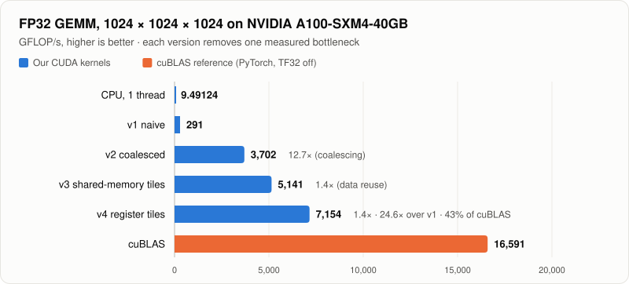
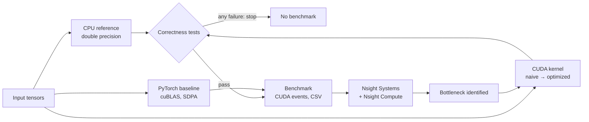
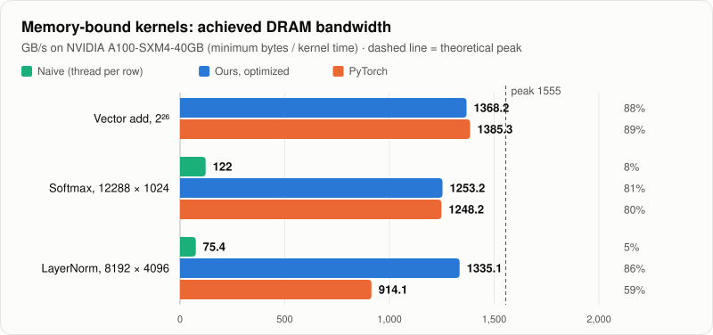
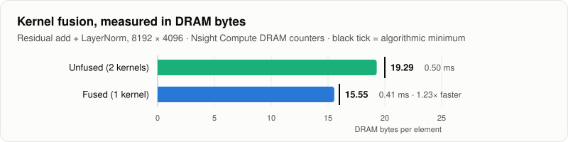
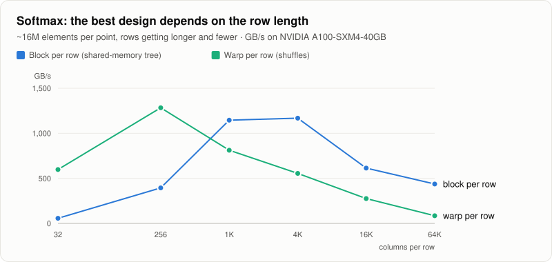
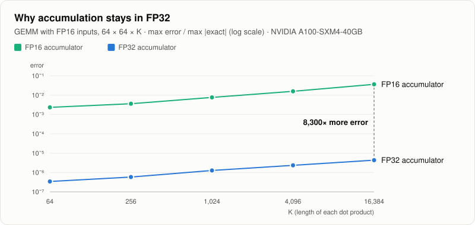
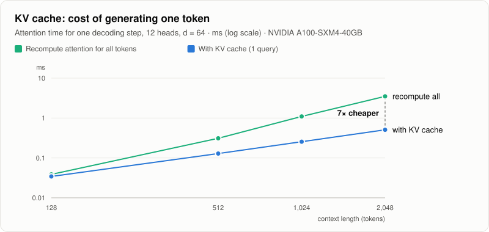

<div align="center">

# CUDA Transformer Inference Performance

**A from-scratch CUDA kernel library for Transformer inference: tested against CPU references,
benchmarked against PyTorch and cuBLAS, profiled with Nsight, and running GPT-2 end to end.**

GEMM · Softmax · LayerNorm · Attention · KV cache · FP16 Tensor Cores · INT8 quantization

[](https://developer.nvidia.com/cuda-toolkit)
[](https://isocpp.org/)
[](benchmarks/)
[](benchmarks/NVIDIA_A100_SXM4_40GB/tests.txt)
[](docs/10_nsight_profiling.md)
[](python/)

[Results](docs/12_results.md) · [Optimization log](docs/11_optimization.md) · [Challenges](docs/11_optimization.md#9-challenges-faced-and-how-they-were-solved) · [Profiling](docs/10_nsight_profiling.md) · [Architecture](docs/01_project_overview.md) · [Docker](docs/docker.md) · [Run it](#run-it)

</div>

---

## Overview

This project implements the core kernels of LLM inference in CUDA C++ without external kernel
libraries: GEMM up to WMMA Tensor Cores, softmax, LayerNorm with residual fusion, fused causal
attention with a KV cache, and INT8 weight-only decode GEMV. They are delivered as one static
library (`ctp_core`) with:

- **Correctness tests**: 7 `ctest` suites that compare every kernel against a double-precision
  CPU reference.
- **Benchmark suite**: 7 programs that write CSV, plus a PyTorch/cuBLAS baseline on the same
  shapes, and a one-command pipeline (`scripts/run_all.sh`) that produces a per-GPU report.
- **Profiling pipeline**: Nsight Compute and Nsight Systems scripts, with stored reports for
  every optimization claim.
- **LLM integration**: a PyTorch extension that runs GPT-2 (124M to 1.5B) on these kernels in
  FP32, FP16 or INT8. In FP32, its logits match Hugging Face to ~1e-6 and its greedy tokens are identical.
- **Deployment**: a Docker image and Compose file for Linux GPU servers, plus Colab notebooks.

The GPU is detected at run time. **Primary platform: NVIDIA A100-SXM4-40GB** (all charts and
headline numbers below). The same code is also measured on a Tesla T4, and GPT-2 runs on an
A100-SXM4-80GB.

## Highlights

NVIDIA A100-SXM4-40GB (108 SMs, 1,555 GB/s, 40 MB L2), CUDA 13.0, FP32 unless noted.
Every kernel is verified against a double-precision CPU reference before it is timed.

<table>
<tr>
<td align="center" width="25%"><h3>24.6×</h3>GEMM speedup, naive → register-tiled<br><sub>291 → 7,154 GFLOP/s · 43% of cuBLAS</sub></td>
<td align="center" width="25%"><h3>1.23×</h3>fused residual-add + LayerNorm<br><sub>19.3 → 15.6 DRAM bytes/element (Nsight)</sub></td>
<td align="center" width="25%"><h3>6.9×</h3>cheaper decode step with KV cache<br><sub>vs recomputing attention, 2K context</sub></td>
<td align="center" width="25%"><h3>1.46×</h3>faster than PyTorch LayerNorm<br><sub>at LLaMA-7B hidden size (8192 × 4096)</sub></td>
</tr>
<tr>
<td align="center" width="25%"><h3>3.2×</h3>INT8 vs FP32 weights, decode GEMV<br><sub>7B-class layer · 1.7× vs FP16</sub></td>
<td align="center" width="25%"><h3>94% → 42%</h3>L1 load when activations are read once per 4 rows<br><sub>INT8 GEMV · Nsight-measured</sub></td>
<td align="center" width="25%"><h3>1.5% vs 20%</h3>INT8 error, per-row vs per-tensor scale<br><sub>with 16 outlier weights</sub></td>
<td align="center" width="25%"><h3>88%</h3>of DRAM peak, vector add<br><sub>1,368 of 1,555 GB/s</sub></td>
</tr>
</table>

<p align="center">
  
</p>

<details>
<summary>Chart data as a table</summary>

| Version | What changed | GFLOP/s | Step gain |
|---|---|---:|---:|
| CPU, 1 thread | reference loop | 9.5 | – |
| v1 naive | one thread per output | 290.6 | – |
| v2 coalesced | `threadIdx.x` → columns (sectors/request 16.5 → 2.5) | 3,701.8 | 12.7× |
| v3 shared-memory tiles | 32×32 tiles, data reuse | 5,140.8 | 1.4× |
| v4 register tiles | 4×4 outer product per thread | 7,153.6 | 1.4× |
| cuBLAS (reference) | NVIDIA's library, TF32 off | 16,591.4 | – |

At 4096³, v4 reaches 8,318 GFLOP/s (43% of FP32 peak).

</details>

---

## What's inside

| Operation | Versions (each tested, benchmarked and profiled) | Key idea |
|---|---|---|
| **GEMM** | naive → coalesced → shared-memory tiled → register-tiled → **WMMA Tensor Cores** (FP16, FP32 accumulate) | memory coalescing, data reuse, outer products, warp-level MMA |
| **Softmax** | thread/row → block/row (shared tree) → warp/row (`__shfl_sync`) → online softmax | numerical stability, parallel reductions |
| **LayerNorm** | thread/row → warp/row → block/row with the row in registers → **fused residual add** | two-pass variance, read-once kernels, kernel fusion |
| **Attention** | unfused (batched GEMM + softmax) → **fused online-softmax kernel**, causal mask, **KV-cache decode** | seq² memory, FlashAttention-style fusion, decode vs prefill |
| **Vector add** | one thread/element → grid-stride loop | indexing, bandwidth ceiling (88% of peak) |
| **Precision** | FP32 vs FP16 vs FP16-in / FP32-accumulate | measured: FP16 accumulation ~8,000× more error at K = 16K, and overflow |
| **Quantization** | decode GEMV with FP32 → FP16 → **INT8 weights** (per-row or per-tensor scale) → INT8 with **2 rows per warp** (activations read once per 2 rows) | weight-only quantization for memory-bound decode; the bottleneck moving DRAM → L1 → parallelism; outliers vs scale granularity |

## How it works



Every optimization follows the same loop: **measure → form a hypothesis → check it with
hardware counters → change one thing → re-measure.** The profiler overturned the hypothesis
three times. Those cases are documented too: [docs/11 §7](docs/11_optimization.md).

## Results (A100-SXM4-40GB)

The bandwidth rows below use data larger than the 40 MB L2, so they measure DRAM, not cache.

### Memory-bound kernels reach 81–88% of peak bandwidth

Softmax, LayerNorm and residual adds do little math per byte, so their ceiling is DRAM
bandwidth. Reading the input once (LayerNorm keeps each row in registers) and picking the right
work split (one block per long row) gets within reach of the hardware limit. Our LayerNorm is
1.46× faster than PyTorch's; softmax and vector add are level with PyTorch.

<p align="center"></p>

<details>
<summary>Data</summary>

| Kernel | Naive | Ours, optimized | PyTorch | Peak |
|---|---:|---:|---:|---:|
| Vector add, 2²⁶ elements | – | 1,368.2 GB/s (88%) | 1,385.3 GB/s | 1,555.2 GB/s |
| Softmax, 12288 × 1024 | 122.0 GB/s | 1,253.2 GB/s (81%) | 1,248.2 GB/s | 1,555.2 GB/s |
| LayerNorm, 8192 × 4096 | 75.4 GB/s | 1,335.1 GB/s (86%) | 914.1 GB/s | 1,555.2 GB/s |

</details>

### Kernel fusion, verified in hardware counters

Fusing the residual add into LayerNorm keeps the intermediate result in registers instead of
writing it to DRAM and reading it back. Nsight Compute's DRAM counters show the saving directly:
the byte ratio (1.24) matches the measured speedup (1.23×). Both pipelines come in slightly under
the algorithmic minimum, so part of their traffic was served by the 40 MB L2 rather than DRAM.

<p align="center"></p>

<details>
<summary>Data</summary>

| Pipeline | DRAM bytes / element | Algorithmic minimum | Time |
|---|---:|---:|---:|
| Unfused: vector add, then LayerNorm (2 kernels) | 19.29 | 20 | 0.500 ms |
| Fused add + LayerNorm (1 kernel) | 15.55 | 16 | 0.406 ms (1.23× faster) |
| PyTorch: add, then `layer_norm` | – | – | 0.588 ms |

</details>

### There is no single best softmax kernel

With one warp per row, short rows are fast. For long rows, too many rows are in flight to stay
in L2, and the kernel re-reads its input from DRAM (measured with Nsight on the T4: 2.77× the
input size; not separately profiled on the A100). One block per row wins from 1,024 columns upward.

<p align="center"></p>

<details>
<summary>Data (GB/s, ~16M elements per point)</summary>

| Columns per row | 32 | 256 | 1K | 4K | 16K | 64K |
|---|---:|---:|---:|---:|---:|---:|
| Block per row | 56.4 | 440.9 | **1,240.6** | **1,166.1** | **615.7** | **437.8** |
| Warp per row | **660.8** | **1,286.3** | 825.7 | 554.1 | 276.1 | 85.0 |

</details>

### FP16 storage, FP32 accumulation

FP16 halves the bytes and unlocks Tensor Cores (our WMMA GEMM: 2.31× over the best FP32 kernel).
But the running sum must stay in FP32: with an FP16 accumulator the error grows with K, and large
sums overflow to infinity.

<p align="center"></p>

<details>
<summary>Data (max error / max |exact|, FP16-rounded inputs)</summary>

| K | 64 | 256 | 1,024 | 4,096 | 16,384 |
|---|---:|---:|---:|---:|---:|
| FP32 accumulator | 3.44e-7 | 5.82e-7 | 1.27e-6 | 2.36e-6 | 4.35e-6 |
| FP16 accumulator | 2.34e-3 | 3.59e-3 | 7.63e-3 | 1.58e-2 | 3.62e-2 |

Overflow test (inputs in [0, 8], K = 8,192): FP16 accumulator produced inf in 256 of 256 outputs;
FP32 accumulation, none.

</details>

### KV cache: 6.9× cheaper decode steps at 2K context

Generating one token with a KV cache means one query against the cached keys. Without the cache,
attention is recomputed for every token, and the gap grows with context length.

<p align="center"></p>

<details>
<summary>Data (ms, fused attention kernel, 12 heads, d = 64)</summary>

| Context (tokens) | 128 | 512 | 1,024 | 2,048 |
|---|---:|---:|---:|---:|
| With KV cache (1 query) | 0.034 | 0.129 | 0.255 | 0.507 |
| Recompute all tokens | 0.038 | 0.309 | 1.087 | 3.500 |
| Ratio | 1.1× | 2.4× | 4.3× | **6.9×** |

The cached decode step takes the same time as on the T4 (0.507 vs 0.503 ms). One query row gives
the kernel little parallel work, which is the likely reason it does not benefit from the A100's
extra SMs and bandwidth (not yet checked in the profiler).

</details>

### INT8 weight-only quantization (decode, 7B-class layers)

FP16 weights are 1.9× faster than FP32, as predicted from the bytes. With the first INT8 kernel,
INT8 weights were only 2.1–2.7× faster, not the predicted 4×. Nsight Compute showed why: weight
bytes did drop 4×, but each weight still needs its activation read through L1, and L1 hit 94% of
its ceiling. A second kernel reads each activation once for 2 rows: **3.2× faster than FP32**
(MLP up; 2.7× on MLP down), with L1 traffic falling exactly as the model predicted. 4 or 8 rows
per warp are slower: too few warps remain to keep DRAM busy. Per-row scales keep the error at
1.5% when a few outlier weights are present; a single per-tensor scale gives 20%
([docs/12 §9.1–9.2](docs/12_results.md#91-int8-weight-only-quantization-decode-gemv-docs08-9)).

All charts are generated from the measured CSV files by
[`assets/make_charts.js`](assets/make_charts.js), so they always match the data:

```bash
node assets/make_charts.js benchmarks/NVIDIA_A100_SXM4_40GB profiling/reports/NVIDIA_A100_SXM4_40GB assets/NVIDIA_A100_SXM4_40GB
```

### Compared with the Tesla T4

The same code, unchanged, on a T4 (40 SMs, 320 GB/s, 4 MB L2). The T4 charts are in [assets/](assets/),
and the full tables in [docs/12](docs/12_results.md).

| Metric | T4 | A100 |
|---|---:|---:|
| Vector add, % of DRAM peak | 82% | **88%** |
| Softmax 12288 × 1024, % of DRAM peak | 76% | **81%** |
| LayerNorm 8192 × 4096, % of DRAM peak | 72% | **86%** |
| GEMM v4 1024³, % of FP32 peak | 27% | **37%** |
| cuBLAS FP32 1024³, % of FP32 peak | 46% | **85%** |
| GEMM v4 as a fraction of cuBLAS | 0.60× | 0.43× |
| WMMA vs best FP32 kernel | 1.49× | **2.31×** |
| KV cache vs recompute, 2K context | 30× | 6.9× |

The memory-bound kernels get closer to peak on the A100, but cuBLAS gains more than our GEMM,
so the gap to cuBLAS grows. The KV-cache ratio falls because recomputing gets 4.3× faster while
the one-query decode step does not ([docs/12 §9](docs/12_results.md#9-nvidia-a100-sxm4-40gb)).

## Profiler-verified results

**A100** (Nsight Compute, [reports](profiling/reports/NVIDIA_A100_SXM4_40GB/)):

| Claim | Evidence |
|---|---|
| INT8 weights cut DRAM traffic exactly 4× | DRAM read **180.4 → 90.2 → 45.2 MB** for FP32 → FP16 → INT8 weights (MLP up, 11008 × 4096) |
| INT8 GEMV is L1-bound, not DRAM-bound | L1/TEX throughput **94%** of peak, DRAM only 49%; global-load sectors match the model (12.68 M predicted, 12.69 M measured) |
| Reading activations once per 4 rows removes the L1 limit | L1 sectors **12.69 M → 4.24 M** (model: 4.23 M), L1 94% → 42%, DRAM 49% → 66% |
| …and moves the limit to parallelism | 344 blocks = **0.64 waves**, achieved occupancy **34%** |
| Fusion speedup = fewer bytes | **19.29 → 15.55 B/element**, ratio 1.24 vs measured 1.23× |
| Coalescing fixes GEMM v1 | global-load sectors/request **16.5 → 2.5** |

**Tesla T4** (deeper GEMM and attention analysis, [reports](profiling/reports/Tesla_T4/)):

| Claim | Evidence |
|---|---|
| Register tiling broke the shared-memory bottleneck | stall reason MIO Throttle → none dominant; cycles/instruction **37.9 → 12.95** |
| No spills, no bank conflicts in the tiled kernels | `LOCAL:0` for all kernels; 0 shared-memory conflicts in GEMM v3/v4 and padded attention GEMM |
| v4 at 60% of cuBLAS | tail effect (2.13 waves), 72 registers → 75% occupancy, 0.86 eligible warps/scheduler |
| WMMA kernel is starved, not slow | issue slots 5.5% busy; 110 of 124 cycles/instruction waiting on global loads |

Full tables and all 16 hypotheses (3 on the A100, 13 on the T4): [docs/10 §9](docs/10_nsight_profiling.md)

<details>
<summary><b>More measured results (A100)</b></summary>

| Operation | Size | Ours (best) | PyTorch | Notes |
|---|---|---|---|---|
| Softmax | 12288 × 1024 | **0.080 ms**, 1,253 GB/s (81% of peak) | 0.081 ms | block per row; warp per row wins for ≤ 256 columns |
| LayerNorm | 8192 × 4096 | **0.201 ms**, 1,335 GB/s (86%) | 0.294 ms | row cached in registers, input read once |
| Add + LayerNorm | 8192 × 4096 | **0.406 ms** (fused) | 0.588 ms (2 kernels) | 1.23× over our unfused, 1.45× over eager PyTorch |
| GEMM, FP32 | 4096³ | 8,318 GFLOP/s (43% of peak) | – | register-tiled v4 |
| GEMM, FP16 Tensor Cores | 1024³ | 16,505 GFLOP/s (2.31× our FP32) | 86,641 GFLOP/s | ours lacks shared-memory staging; see profiling |
| Attention, causal | 12 × 2048 × 64 | 3.27 ms unfused, 3.48 ms fused | – | fused needs no 192 MB score matrix, but runs at 0.94× the unfused speed here (1.21× faster on the T4) |
| Decode GEMV, 7B-class MLP up | 11008 × 4096 | 0.042 ms, INT8 weights | – | 0.136 ms FP32, 0.070 ms FP16 weights |

Everything, including negative results and caveats: [docs/12 §9](docs/12_results.md#9-nvidia-a100-sxm4-40gb)

</details>

---

## Run it

**Google Colab (no setup):** open [`notebooks/colab_run.ipynb`](notebooks/colab_run.ipynb),
choose `Runtime → Change runtime type → GPU`, run the cells. Profiling:
[`notebooks/colab_profile.ipynb`](notebooks/colab_profile.ipynb).

**Any Linux machine with an NVIDIA GPU:**

```bash
bash scripts/run_all.sh        # build → tests (stops on failure) → benchmarks → summary
# results: benchmarks/<GPU>/summary.md
```

**Docker (any Linux server with an NVIDIA GPU, no local CUDA install):**

```bash
docker build -t cuda-transformer-performance .
docker run --rm --gpus all -v "$PWD/benchmarks:/workspace/cuda-transformer-performance/benchmarks" cuda-transformer-performance
```

Profiling, GPT-2, Jupyter / Colab local runtime, volumes and troubleshooting: [docs/docker.md](docs/docker.md).

Individual steps:

```bash
cmake -S . -B build -DCMAKE_BUILD_TYPE=Release && cmake --build build -j
ctest --test-dir build --output-on-failure        # correctness first
./build/bench_matmul --csv matmul.csv             # any bench_*; --csv is optional
python3 python/benchmark.py --ops matmul softmax  # PyTorch baseline
bash profiling/ncu_kernels.sh gemm                # Nsight Compute on one case
```

**Other GPUs (A100, H100, …):** no code changes needed. The GPU is detected at run time, and
results go to `benchmarks/<GPU>/` and `profiling/reports/<GPU>/`, so runs never overwrite each
other. Before interpreting results, read the caveats (MIG slices, larger L2 caches, features our
kernels don't use): [docs/09 §21](docs/09_benchmarking.md).

**Generate text with a real LLM on these kernels** (GPT-2 from Hugging Face; every linear layer,
LayerNorm and the attention run on this project's kernels, with FP32, FP16 or INT8 weights). It
checks the logits and the generated text against Hugging Face, then measures tokens per second:

```bash
pip install transformers
python3 llm/run_gpt2.py --verify --bench --model gpt2 --csv benchmarks/<GPU>/gpt2.csv   # or gpt2-xl
```

Measured on an A100-SXM4-80GB: for GPT-2 (124M) and GPT-2 XL (1.5B), FP32 logits match Hugging Face
to ~1e-6 and all 32 greedy tokens are identical; with INT8 weights GPT-2 XL also matches 32/32.
Speed: decoding at batch 1 is launch-bound (~15 kernel launches per layer). On GPT-2 XL, FP16
weights are 1.16× faster than FP32 (7.5 → 6.5 ms per token), but INT8 adds nothing on top: both sit
on the ~6.2 ms launch floor. The ~5× over Hugging Face eager is Python/framework overhead, not the
kernels. Details: [docs/14](docs/14_llm_integration.md).

**Requirements:** an NVIDIA GPU (detected at runtime; Tensor Core tests need compute
capability ≥ 7.0), CUDA Toolkit 11+, CMake ≥ 3.18, a C++17 compiler; PyTorch for the baseline
(`pip install -r requirements.txt`; preinstalled on Colab). If CMake rejects `native`
architectures, pass e.g. `-DCMAKE_CUDA_ARCHITECTURES=80` (A100) or `75` (T4).

## Project layout

```
kernels/        CUDA kernels + their launch functions (one file per operation)
src/cpu/        CPU reference implementations (ground truth)
src/utils/      error checking, RAII GPU memory, CUDA-event timers, device query
src/benchmark/  benchmark programs, CSV logger, profiling driver
tests/          correctness tests (ctest)
python/         PyTorch baseline and results summarizer
scripts/        run_all.sh: build → test → benchmark → summary
profiling/      Nsight scripts and reports
llm/            GPT-2 text generation on these kernels (PyTorch extension)
notebooks/      Colab notebooks
benchmarks/     measured results, one folder per GPU
assets/         README charts, generated from the results by make_charts.js
docker/         container entry point (Dockerfile and docker-compose.yml at the root)
docs/           design notes, results and profiling analysis (below)
```

## Technical documentation

| Area | Documents |
|---|---|
| Architecture | [Project overview](docs/01_project_overview.md) · [Execution model and vector add](docs/02_cuda_fundamentals.md) · [Memory hierarchy and roofline](docs/03_memory_hierarchy.md) |
| Kernel design | [GEMM](docs/04_matrix_multiplication.md) · [Softmax](docs/05_softmax.md) · [LayerNorm and fusion](docs/06_layernorm.md) · [Attention and KV cache](docs/07_attention.md) · [Precision and quantization](docs/08_precision.md) |
| Performance | [Benchmarking methodology](docs/09_benchmarking.md) · [Nsight profiling](docs/10_nsight_profiling.md) · [Optimization log and challenges](docs/11_optimization.md) · [Results](docs/12_results.md) |
| Integration and deployment | [GPT-2 on the kernels](docs/14_llm_integration.md) · [Docker](docs/docker.md) |

## Limitations

- Measured on **two Colab GPUs**: the main results on an A100-SXM4-40GB (the latest of four runs;
  GPU rows agree within about 1% between runs,
  [docs/12 §9](docs/12_results.md#9-nvidia-a100-sxm4-40gb)), and a Tesla T4 for comparison (one run;
  its clock visibly throttles on long kernels). The charts above are A100 data.
- PyTorch comparisons are **FP32, eager mode, these shapes**. cuBLAS remains faster than our GEMMs.
- The fused attention kernel is FlashAttention-*style* (online softmax, no score matrix),
  not FlashAttention: it has no query/key tiling or Tensor Cores.
- Quantization is **INT8 weight-only, for the decode GEMV only** (per-row or per-tensor scales).
  No INT4, no group-wise scales, no INT8 Tensor Cores or activation quantization, and the weights
  are random, not a real model. Measured on the A100 only ([docs/12 §9.1](docs/12_results.md)).
